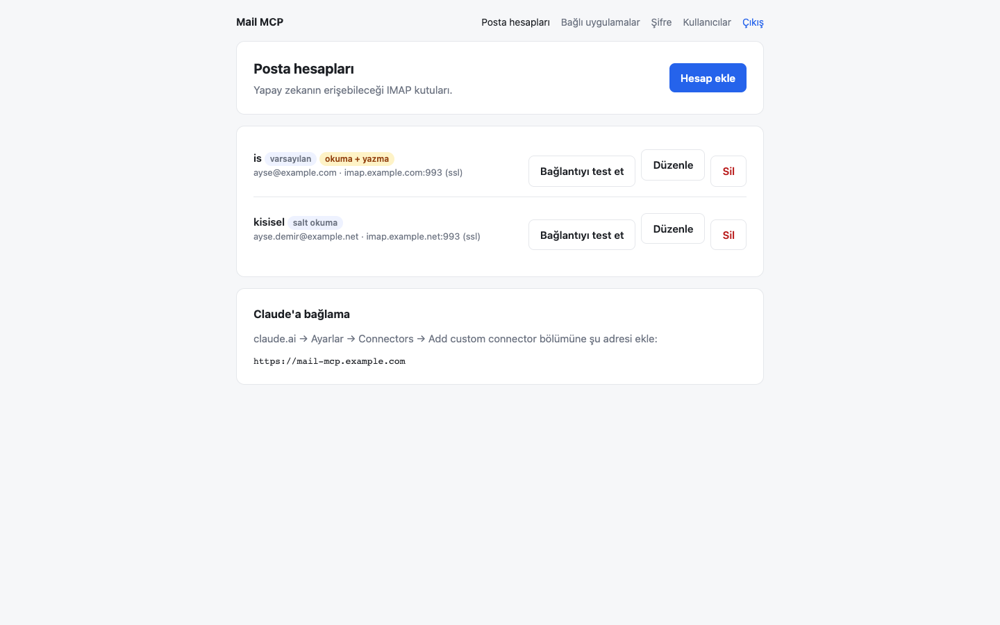

🇬🇧 English | [🇹🇷 Türkçe](README.tr.md)

# imap-mcp

An MCP server that exposes IMAP mailboxes to AI clients (Claude, ChatGPT, Cursor…), protected
with OAuth 2.1. Built with Laravel 13, [laravel/mcp](https://github.com/laravel/mcp) and
[webklex/php-imap](https://github.com/Webklex/php-imap).



More: [Feature guide](docs/features.md)

- **Read-only by default.** Creating folders, moving, flagging and deleting are enabled per account.
- Read tools never mark messages as seen. It does not send mail.
- A user can have several IMAP accounts; passwords are stored encrypted with `APP_KEY`.
- Add it straight to claude.ai as a custom connector: OAuth discovery and Dynamic Client Registration are built in.

## Tools

**Read** (every account):

| Tool | What it does |
|---|---|
| `list-accounts` | The user's accounts and whether writing is allowed |
| `list-folders` | Folders with total/unread counts |
| `search-emails` | Search by from / to / subject / text / since / before / unseen; summary list without bodies (max 50) |
| `get-email` | One message by UID: headers, plain-text body (cut at 20k characters), attachment list |

Without criteria, `search-emails` looks at the last 7 days; it never scans huge mailboxes in full.

**Write** (only on accounts with write access; users without it never see these tools):

| Tool | What it does |
|---|---|
| `get-email` + `move_to` / `mark_seen` | After reading, move the message to a folder and/or mark it seen |
| `move-emails` | Move messages (max 50) to another folder |
| `flag-emails` | Mark seen/unseen, flagged/unflagged |
| `create-folder` | Create a folder (non-ASCII names supported) |
| `delete-emails` | Default: move to Trash. `permanent=true`: permanently delete, only from the Trash folder |
| `delete-folder` | Delete only empty folders that have no subfolders and are not system folders |

Example prompt: *"Read the unread invoices, summarise them and move all of them to Invoices/2026."*
Claude finds the messages with `search-emails`, then calls
`get-email(uid, move_to: "Invoices/2026", mark_seen: true)` for each one.

## Quick start (Docker)

```bash
mkdir imap-mcp && cd imap-mcp
```

```bash
curl -O https://raw.githubusercontent.com/bahricanli/imap-mcp/main/docker-compose.release.yml
```

```bash
curl -o .env https://raw.githubusercontent.com/bahricanli/imap-mcp/main/.env.example
```

Set `APP_URL`, `APP_KEY`, `NPM_NETWORK` and `APP_PORT` in `.env`, then:

```bash
docker compose -f docker-compose.release.yml up -d
```

```bash
docker compose -f docker-compose.release.yml exec mail-mcp php artisan mail:create-user
```

Images: `ghcr.io/bahricanli/imap-mcp` and `bahricanli/imap-mcp` (amd64 + arm64).
Full walkthrough: [Docker installation](docs/docker-install.md).

## Connecting

- **claude.ai:** Settings → Connectors → Add custom connector → `https://your-domain/` (the root URL).
  A login screen opens in the browser, followed by a consent screen.
- **Claude Code:** `claude mcp add --transport http mail https://your-domain/`
- **Test:** `php artisan mcp:inspector /`

The web panel is at `https://your-domain/panel`; the MCP server itself is at the root URL.

## Security

- Use an **app password** instead of your main password for Mailcow / Gmail / Outlook.
- No open sign-up; users are added with `mail:create-user` or by an admin in the panel. Login attempts are limited to 5 per minute.
- **Prompt injection:** email content is untrusted data. An incoming message can say "delete this folder".
  That is why write access is off by default and the server instructions tell the model to write only on the
  user's explicit request. The real safeguards are server-side:
  - Deleting moves to Trash first; permanent deletion only works inside Trash, as a separate step.
  - System folders and non-empty folders cannot be deleted.
  - At most 50 messages per call.
  - Every write is logged with user, account, folder and UIDs (`docker compose logs mail-mcp`).
- Write tools carry the MCP `destructive` / `idempotent` hints, so Claude can ask for confirmation.

To report a vulnerability, see [SECURITY.md](SECURITY.md).

## Documentation

| Document | Contents |
|---|---|
| [Docker installation](docs/docker-install.md) | Pre-built image or build from source, `.env`, Nginx Proxy Manager, updates, backups, troubleshooting |
| [Feature guide](docs/features.md) | Every screen of the web panel, with screenshots |
| [Docker details](docs/docker.md) | Image contents, compose files, tags, CI |
| [Architecture](docs/architecture.md) | Request flow, OAuth, data model, IMAP handling |
| [Administration](docs/admin.md) | Artisan commands, users, write access, logs |
| [Development](docs/development.md) | Local setup, tests, code style |
| [Changelog](CHANGELOG.md) | Release notes |
| [Contributing](CONTRIBUTING.md) | How to report bugs and send changes |
| [Security policy](SECURITY.md) | Supported versions, private reporting |

## Roadmap

- [x] Add / delete accounts and set write access from the web panel
- [ ] Attachment download (signed, expiring URL)
- [ ] Draft creation (without sending)
- [ ] End-to-end IMAP tests against a real Dovecot container (CI)

## License

[MIT](LICENSE)
