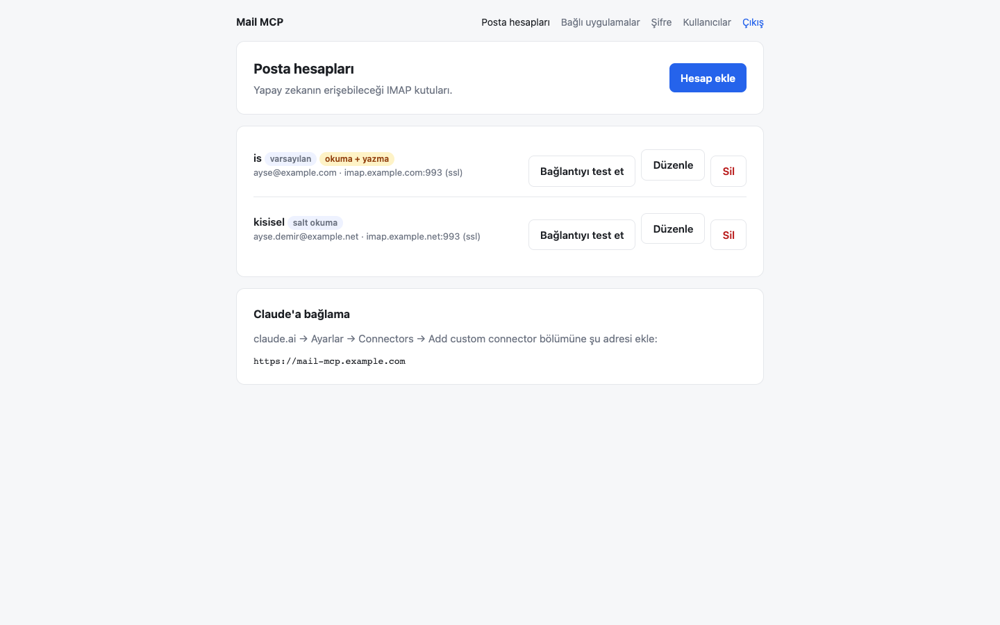

🇹🇷 Türkçe | [🇬🇧 English](README.md)

# imap-mcp

IMAP posta kutularını yapay zeka istemcilerine (Claude, ChatGPT, Cursor…) açan, OAuth 2.1 ile
korunan bir MCP sunucusu. Laravel 13 + [laravel/mcp](https://github.com/laravel/mcp)
+ [webklex/php-imap](https://github.com/Webklex/php-imap).



Daha fazla: [Özellik rehberi](docs/features.tr.md)

- Varsayılan olarak **salt-okunur**; klasör oluşturma, taşıma, işaretleme ve silme hesap bazında açılır.
- Okuma araçları mesajları okundu işaretlemez. Mail göndermez.
- Bir kullanıcının birden fazla IMAP hesabı olabilir; şifreler `APP_KEY` ile şifreli saklanır.
- claude.ai custom connector'a doğrudan eklenir: OAuth keşfi ve Dynamic Client Registration hazır.

## Araçlar

**Okuma** (her hesapta):

| Araç | Ne yapar |
|---|---|
| `list-accounts` | Kullanıcının hesapları ve yazma izni olup olmadığı |
| `list-folders` | Klasörler + toplam/okunmamış sayısı |
| `search-emails` | from / to / subject / text / since / before / unseen ile arama; gövdesiz özet liste (en fazla 50) |
| `get-email` | UID ile tek mesaj: başlıklar, düz metin gövde (20k karakterde kesilir), ek listesi |

Kriter verilmezse `search-emails` son 7 güne bakar; dev kutularda tam tarama yapmaz.

**Yazma** (sadece yazma izni açık hesaplarda; izni olmayan kullanıcılar bu araçları hiç görmez):

| Araç | Ne yapar |
|---|---|
| `get-email` + `move_to` / `mark_seen` | Okuduktan sonra mesajı bir klasöre taşır ve/veya okundu işaretler |
| `move-emails` | Mesajları (en fazla 50) başka klasöre taşır |
| `flag-emails` | Okundu/okunmadı, yıldızlı/yıldızsız işaretler |
| `create-folder` | Klasör oluşturur (Türkçe karakter destekli) |
| `delete-emails` | Varsayılan: Çöp'e taşır. `permanent=true`: sadece Çöp klasöründen kalıcı siler |
| `delete-folder` | Sadece boş, alt klasörü olmayan, sistem klasörü olmayan klasörleri siler |

Örnek istek: *"Okunmamış faturaları oku, özetle ve hepsini Faturalar/2026 klasörüne taşı."*
Claude `search-emails` ile mesajları bulur. Ardından her biri için
`get-email(uid, move_to: "Faturalar/2026", mark_seen: true)` çağırır.

## Hızlı başlangıç (Docker)

```bash
mkdir imap-mcp && cd imap-mcp
```

```bash
curl -O https://raw.githubusercontent.com/bahricanli/imap-mcp/main/docker-compose.release.yml
```

```bash
curl -o .env https://raw.githubusercontent.com/bahricanli/imap-mcp/main/.env.example
```

`.env` içinde `APP_URL`, `APP_KEY`, `NPM_NETWORK` ve `APP_PORT` değerlerini ayarla, sonra:

```bash
docker compose -f docker-compose.release.yml up -d
```

```bash
docker compose -f docker-compose.release.yml exec mail-mcp php artisan mail:create-user
```

İmajlar: `ghcr.io/bahricanli/imap-mcp` ve `bmericc/imap-mcp` (amd64 + arm64).
Adım adım anlatım: [Docker ile kurulum](docs/docker-install.tr.md).

## Bağlanma

- **claude.ai:** Ayarlar → Connectors → Add custom connector → `https://alanadin/` (kök adres).
  Tarayıcıda giriş ekranı, ardından onay ekranı açılır.
- **Claude Code:** `claude mcp add --transport http mail https://alanadin/`
- **Test:** `php artisan mcp:inspector /`

Web paneli `https://alanadin/panel` adresinde; MCP sunucusu kök adreste.

## Güvenlik

- Mailcow / Gmail / Outlook için ana şifre yerine **uygulama şifresi** kullan.
- Açık kayıt yok; kullanıcılar `mail:create-user` ile ya da panelden bir yönetici tarafından eklenir. Giriş denemeleri dakikada 5 ile sınırlı.
- **Prompt injection:** e-posta içeriği güvenilmeyen veridir. Gelen bir mail "bu klasörü sil" diyebilir.
  Bu yüzden yazma izni varsayılan kapalı. Sunucu talimatları modele yazma işlemlerini sadece kullanıcının
  açık isteğiyle yapmasını söylüyor. Yine de asıl güvence aşağıdaki sunucu tarafı kurallar:
  - Silme önce Çöp'e taşır; kalıcı silme sadece Çöp klasöründen, ayrı bir adımla yapılır.
  - Sistem klasörleri ve dolu klasörler silinemez.
  - Tek çağrıda en fazla 50 mesaj işlenir.
  - Tüm yazma işlemleri kullanıcı, hesap, klasör ve uid'lerle loglanır (`docker compose logs mail-mcp`).
- Yazma araçları MCP `destructive` / `idempotent` işaretleriyle gelir; Claude bunlar için onay isteyebilir.

Güvenlik açığı bildirmek için: [SECURITY.md](SECURITY.md).

## Dokümantasyon

| Belge | İçerik |
|---|---|
| [Docker ile kurulum](docs/docker-install.tr.md) | Hazır imaj veya kaynak koddan kurulum, `.env`, Nginx Proxy Manager, güncelleme, yedekleme, sık sorunlar |
| [Özellik rehberi](docs/features.tr.md) | Web panelinin tüm ekranları, ekran görüntüleriyle |
| [Docker ayrıntıları](docs/docker.tr.md) | İmaj içeriği, compose dosyaları, etiketler, CI |
| [Mimari](docs/architecture.tr.md) | İstek akışı, OAuth, veri modeli, IMAP |
| [Yönetim](docs/admin.tr.md) | Artisan komutları, kullanıcılar, yazma izni, loglar |
| [Geliştirme](docs/development.tr.md) | Yerel kurulum, testler, kod stili |
| [Değişiklik günlüğü](CHANGELOG.md) | Sürüm notları |
| [Katkı](CONTRIBUTING.md) | Hata bildirme ve değişiklik gönderme |
| [Güvenlik politikası](SECURITY.md) | Desteklenen sürümler, gizli bildirim |

## Yol haritası

- [x] Web panelden hesap ekleme / silme ve yazma izni
- [ ] Ek indirme (imzalı, süreli URL)
- [ ] Taslak oluşturma (göndermeden)
- [ ] Gerçek Dovecot konteyneriyle uçtan uca IMAP testleri (CI)

## Lisans

[MIT](LICENSE)
