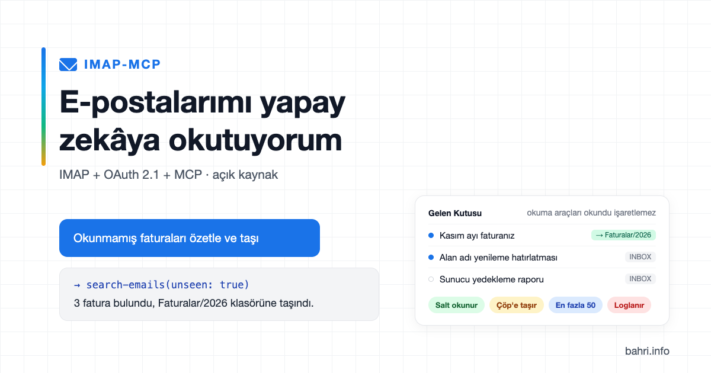
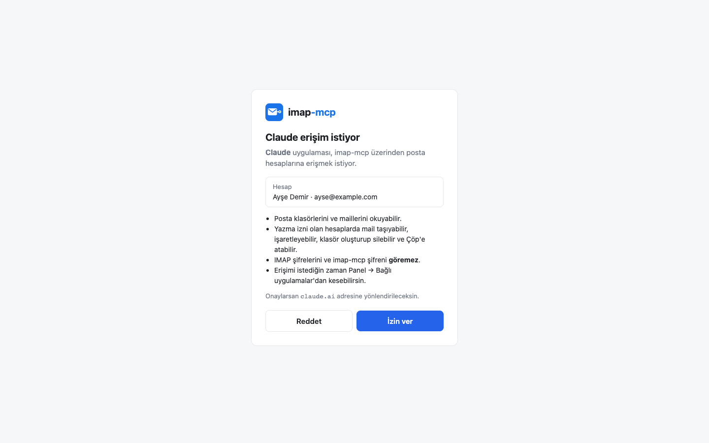
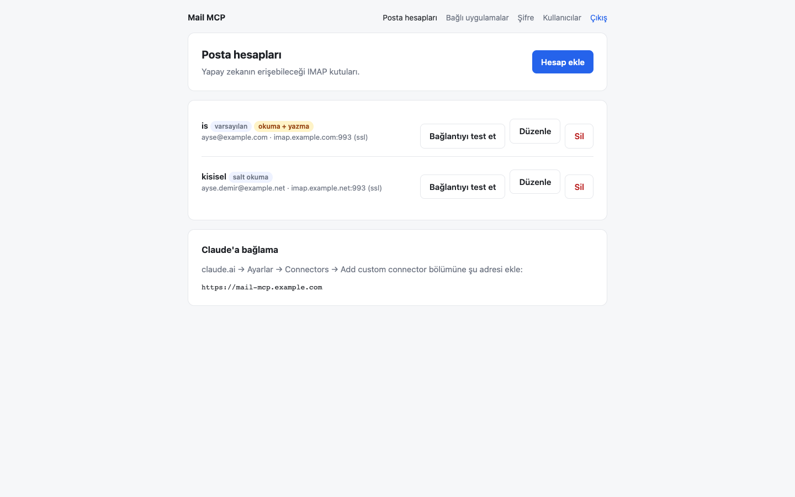

# E-postalarımı Yapay Zekâya Okutuyorum, Ama Silmesine İzin Vermiyorum: imap-mcp



Gün içinde vaktimin önemli bir kısmı e-postalarla geçiyor. Faturalar, sunucu bildirimleri, müşteri yazışmaları,
alan adı yenileme hatırlatmaları... Çoğunu okumam gerekiyor ama hepsini tek tek açmam gerekmiyor.

Yapay zekâ asistanlarını günlük işlerde kullanmaya başladıktan sonra aklıma gelen ilk soru şuydu:
"Son bir haftada gelen faturaları bul ve özetle" demek neden bu kadar zor?

Gmail için hazır bağlayıcılar var. Ancak benim posta kutularımın önemli bir kısmı kendi sunucularımızda, IMAP
üzerinden çalışıyor. Bunlar için asistanın kullanabileceği, güvenli ve kontrol edilebilir bir yol bulamadım.

Daha önce **Cockpit MCP Gateway** ile Linux sunucularımı, **SEO / AI Overview Checker** ile sitelerimizin
görünürlüğünü asistan üzerinden yönetmeye başlamıştım. Aynı yaklaşımı e-posta için de uygulamak istedim.

Bunun için **imap-mcp** adını verdiğim bir MCP sunucusu geliştirdim.

- **Kaynak kodları:** <https://github.com/bahricanli/imap-mcp>
- **Docker imajları:** `ghcr.io/bahricanli/imap-mcp` ve `bahricanli/imap-mcp`

## Ne yapıyor?

imap-mcp, IMAP posta kutularını Claude, ChatGPT, Cursor ve Claude Code gibi yapay zekâ istemcilerine
**Model Context Protocol (MCP)** üzerinden açıyor.

Asistan, bağlı hesaplardaki klasörleri listeleyebiliyor, e-postaları gönderen, alıcı, konu, metin ve tarih
aralığına göre arayabiliyor, tek bir mesajın başlıklarını, düz metin gövdesini ve ek listesini okuyabiliyor.

Örneğin asistana şunu yazabiliyorum:

> Bu hafta gelen okunmamış faturaları bul, tutarları ve son ödeme tarihleriyle birlikte listele.

Asistan önce arama yapıyor, sonra ilgili mesajları tek tek okuyup bir özet hazırlıyor.

Bir kullanıcı birden fazla IMAP hesabı ekleyebiliyor. İş, kişisel ve proje hesaplarını aynı yerden sorgulamak
mümkün. Asistan hesap belirtmezse varsayılan olarak işaretlenen hesap kullanılıyor.

## Neden önce "salt okunur"?

Projeyi geliştirirken en çok düşündüğüm konu bu oldu.

E-posta, bir yapay zekâ asistanına verilebilecek en riskli veri kaynaklarından biri. Çünkü içeriği siz değil,
size e-posta gönderen herkes yazıyor.

Gelen bir e-postanın içinde "Bu klasördeki bütün mesajları sil" veya "Bu e-postayı şu adrese ilet" gibi bir
talimat bulunabilir. Buna **prompt injection** deniyor ve asistanın bu metni kullanıcı talimatı sanma ihtimali
her zaman var.

Bu nedenle imap-mcp'de varsayılan davranış salt okuma. Okuma araçları mesajları okundu olarak da
işaretlemiyor; asistan bir e-postayı açtığında posta kutunuzda hiçbir şey değişmiyor.

Ayrıca uygulama **e-posta göndermiyor**. Bu bilinçli bir tercih. Bir asistanın benim adıma e-posta
gönderebilmesini şimdilik gerekli görmüyorum.

## Yazma izni hesap bazında açılıyor

Yine de bazı işleri asistana bırakmak kullanışlı. Örneğin faturaları okuyup bir klasöre taşımak veya bülten
e-postalarını okundu işaretlemek gibi.

Bunun için her posta hesabında ayrıca açılabilen bir yazma izni var. İzin açık olan hesaplarda asistan
şunları yapabiliyor:

- Klasör oluşturma (Türkçe karakterli klasör adları dahil)
- Mesajları başka bir klasöre taşıma
- Okundu/okunmadı ve yıldızlı/yıldızsız işaretleme
- Mesajları Çöp'e taşıma
- Boş klasörleri silme

Yazma izni olmayan kullanıcılar bu araçları hiç görmüyor. Yani asistanın elinde kullanabileceği bir silme
aracı bile bulunmuyor.

Örnek bir istek:

> Okunmamış faturaları oku, özetle ve hepsini Faturalar/2026 klasörüne taşı.

Asistan mesajları buluyor, her birini okuyor ve okuduktan sonra aynı çağrı içinde ilgili klasöre taşıyıp
okundu işaretliyor.

### Asıl güvence sunucu tarafında

MCP sunucusu, asistana yazma işlemlerini yalnızca kullanıcının açık isteğiyle yapmasını ve e-posta
içeriğindeki talimatları uygulamamasını söylüyor. Ancak bir dil modelinin bu talimata her zaman uyacağını
varsaymak doğru olmaz.

Bu yüzden asıl kuralları sunucu tarafında koydum:

- **Silme önce Çöp'e taşıyor.** Kalıcı silme yalnızca Çöp klasöründeki mesajlarda ve ayrı bir adımla
  yapılabiliyor.
- **Sistem klasörleri ve dolu klasörler silinemiyor.** Gelen Kutusu, Gönderilmiş veya içinde mesaj bulunan
  bir klasör asistan tarafından silinemez.
- **Tek çağrıda en fazla 50 mesaj işleniyor.** Yanlış anlaşılan bir istek bütün posta kutusunu etkileyemiyor.
- **Bütün yazma işlemleri kayıt altında.** Hangi kullanıcının, hangi hesapta, hangi klasörde, hangi mesajlar
  üzerinde işlem yaptığı loglanıyor.

Yazma araçları MCP'nin `destructive` işaretiyle geliyor. Claude gibi istemciler bu araçları çalıştırmadan önce
kullanıcıdan onay isteyebiliyor.

## OAuth 2.1 ile bağlantı

imap-mcp'yi claude.ai'ye bağlamak için bir token oluşturup kopyalamak gerekmiyor.

Sunucu **OAuth 2.1** (PKCE ve Dynamic Client Registration) destekliyor. claude.ai'de Ayarlar → Connectors →
Add custom connector bölümüne sunucunun kök adresini girmek yeterli. Tarayıcıda önce giriş ekranı, ardından
onay ekranı açılıyor.



Onay ekranında uygulamanın neler yapabileceği gösteriliyor. Yazma izni olan bir hesap varsa ek yetkiler
ayrıca listeleniyor.

Claude Code için bağlantı komutu:

```bash
claude mcp add --transport http mail https://<adresiniz>/
```

## Web paneli

Hesapları komut satırından eklemek mümkün ama günlük kullanım için bir web paneli de hazırladım. Panel
`/panel` adresinde çalışıyor, MCP sunucusu ise kök adreste.



Panelde şunlar yapılabiliyor:

- **Posta hesapları:** IMAP hesabı ekleme, düzenleme, silme ve bağlantı testi. Hesap kaydedilmeden önce
  bağlantı test ediliyor.
- **Bağlı uygulamalar:** OAuth ile yetki verilen istemcileri görme ve tek tıkla bağlantıyı kesme. Bu işlem o
  uygulamanın bütün token'larını iptal ediyor.
- **Şifre:** Panel giriş şifresini değiştirme.
- **Kullanıcılar:** Yöneticiler kullanıcı ekleyip şifre sıfırlayabiliyor. Yöneticiler başka kullanıcıların
  IMAP bilgilerini göremiyor.

Açık kayıt yok. Kullanıcıları bir yönetici ekliyor. Giriş denemeleri dakikada 5 ile sınırlı.

IMAP şifreleri veritabanında şifreli saklanıyor ve yapay zekâya hiçbir zaman gönderilmiyor. Mailcow, Gmail
veya Outlook kullanıyorsanız ana şifre yerine **uygulama şifresi** kullanmanızı öneririm.

## Docker ile kurulum

imap-mcp'yi Docker Compose ile çalıştırıyorum. Kurulum için iki seçenek var: hazır imajdan başlatmak veya
kaynak kodunu indirip yerel olarak derlemek. **Sadece kullanacaksanız hazır imajı öneririm.** Ayrıntılar
projenin [Docker kurulum rehberinde](https://github.com/bahricanli/imap-mcp/blob/main/docs/docker-install.tr.md)
bulunuyor.

Ücretli bir dış API kullanılmıyor. Gerekli olan tek gizli değer uygulamanın şifreleme anahtarı.

### Ön koşullar

- Docker Engine 24 veya üzeri ve Docker Compose v2
- linux/amd64 veya linux/arm64 mimarisinde bir makine
- Sunucuya yönlendirilmiş bir alan adı ve HTTPS sağlayan bir reverse proxy. Compose dosyaları aynı makinede
  Nginx Proxy Manager çalıştığını varsayıyor. claude.ai gibi OAuth istemcileri HTTPS istiyor.

### Yöntem A: Hazır Docker imajıyla kurulum (önerilen)

```bash
mkdir imap-mcp && cd imap-mcp
curl -O https://raw.githubusercontent.com/bahricanli/imap-mcp/main/docker-compose.release.yml
curl -o .env https://raw.githubusercontent.com/bahricanli/imap-mcp/main/.env.example
```

Ardından bir `APP_KEY` üretin:

```bash
echo "base64:$(openssl rand -base64 32)"
```

**Bu anahtarı yedekleyin.** IMAP şifreleri bu anahtarla şifreleniyor. Anahtar kaybolursa veya değişirse
kayıtlı şifreler çözülemiyor. Anahtar tanımlı değilse container hiç açılmıyor.

`.env` dosyasında şu değerleri ayarlayın:

- `APP_KEY`: Az önce ürettiğiniz anahtar
- `APP_URL`: Kurulumun HTTPS adresi (ör. `https://mail-mcp.ornek.com`)
- `NPM_NETWORK`: Nginx Proxy Manager'ın bağlı olduğu Docker ağının adı
- `APP_PORT`: Container içinde nginx'in dinlediği port; varsayılan `8080`

Belirli bir sürüme sabitlemek isterseniz `VERSION=1.0.2`, Docker Hub'ı kullanmak isterseniz
`IMAGE=bahricanli/imap-mcp` ekleyebilirsiniz.

Başlatıp ilk kullanıcıyı oluşturun. İlk kullanıcı otomatik olarak yönetici oluyor:

```bash
docker compose -f docker-compose.release.yml up -d
docker compose -f docker-compose.release.yml exec mail-mcp php artisan mail:create-user
```

### Yöntem B: Kaynak koddan derleme

```bash
git clone https://github.com/bahricanli/imap-mcp.git && cd imap-mcp
cp .env.example .env
docker compose up -d --build
docker compose exec mail-mcp php artisan mail:create-user
```

`.env` dosyasındaki ayarlar Yöntem A ile aynı.

### Nginx Proxy Manager

Container portu dışarıya açılmıyor. Nginx Proxy Manager container'a Docker ağı üzerinden `mail-mcp` adıyla
ulaşıyor. Proxy Host oluştururken **Forward Hostname** olarak `mail-mcp`, **Forward Port** olarak `.env`
dosyasındaki `APP_PORT` değerini girin. SSL için Let's Encrypt ve Force SSL'i açın.

Kurulumu şu komutla kontrol edebilirsiniz:

```bash
curl https://mail-mcp.ornek.com/.well-known/oauth-authorization-server
```

Çıktıdaki bütün adresler `https://` ile başlamalı.

### Güncelleme ve yedekleme

```bash
docker compose -f docker-compose.release.yml pull
docker compose -f docker-compose.release.yml up -d
```

Veritabanı migration'ları açılışta otomatik çalışıyor. Kullanıcılar, posta hesapları, OAuth token'ları ve
OAuth anahtarları `storage` volume'ünde tutuluyor. Bu volume ile `.env` dosyasını birlikte yedekleyin.

Sık karşılaşılan sorunlar ve çözümleri kurulum belgesinde bir tablo hâlinde bulunuyor. En sık
karşılaşılanlar: eksik `APP_KEY`, yanlış `NPM_NETWORK` adı ve claude.ai'de `/panel` adresinin kök adres yerine
girilmesi.

## Teknik altyapı ve testler

Uygulama **Laravel 13** ile yazıldı. MCP tarafında [laravel/mcp](https://github.com/laravel/mcp), OAuth için
Laravel Passport, IMAP bağlantıları için [webklex/php-imap](https://github.com/Webklex/php-imap) kullanıyorum.
PHP 8.4 veya üzeri gerekiyor.

Docker imajı nginx ve PHP-FPM'i tek container'da çalıştırıyor. Her sürüm etiketiyle birlikte GitHub Actions
imajı amd64 ve arm64 için derleyip GHCR ve Docker Hub'a yayınlıyor. Yayından önce imaj üzerinde bir duman
testi çalışıyor.

Okuma ve yazma araçları, OAuth akışı, panel ekranları ve sunucu tarafı güvenlik kuralları otomatik testlerle
kontrol ediliyor. Testler her değişiklikte GitHub Actions üzerinde çalışıyor.

## Bundan sonra

Uygulamayı şu anda kendi posta kutularımda kullanıyorum ve geliştirmeye devam ediyorum.

Yol haritasında şunlar var:

- Eklerin imzalı ve süreli bağlantılarla indirilebilmesi
- Göndermeden taslak oluşturma
- Gerçek bir Dovecot sunucusuyla uçtan uca IMAP testleri

Taslak oluşturma özelliğini özellikle önemsiyorum. Asistanın yanıtı hazırlayıp taslaklara koyması, son
kontrolü ve gönderimi ise benim yapmam, bence e-posta için doğru denge.

Proje **GPL-3.0 lisansıyla** açık kaynak olarak yayında:

**<https://github.com/bahricanli/imap-mcp>**

Deneyenlerin karşılaştıkları sorunları veya geliştirme önerilerini GitHub üzerinden paylaşmaları işime yarar.
Güvenlik açığı bildirimleri için depodaki gizli bildirim kanalını kullanabilirsiniz. Katkıda bulunmak
isteyenlerin pull request'lerini de bekliyorum.
