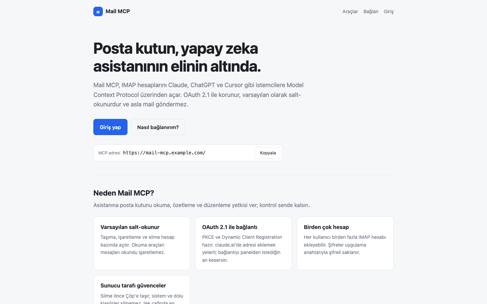
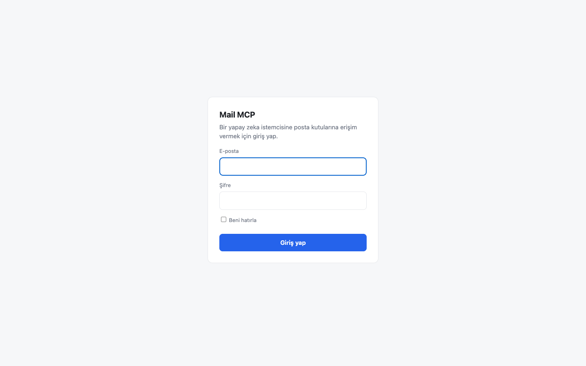
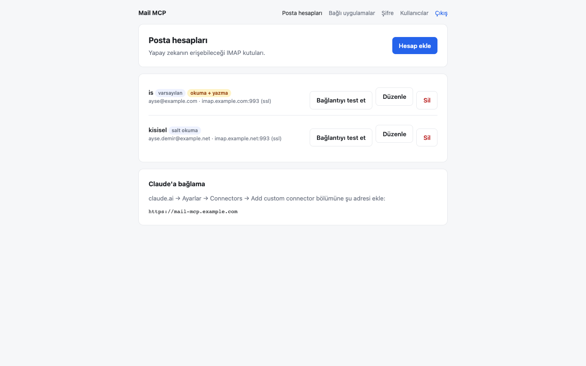
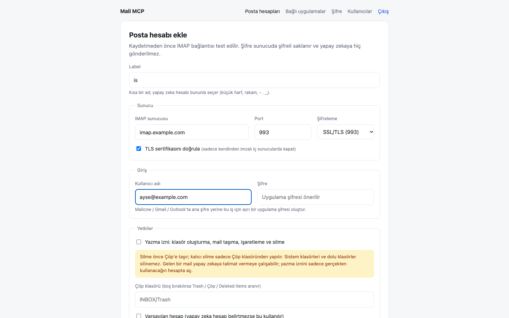
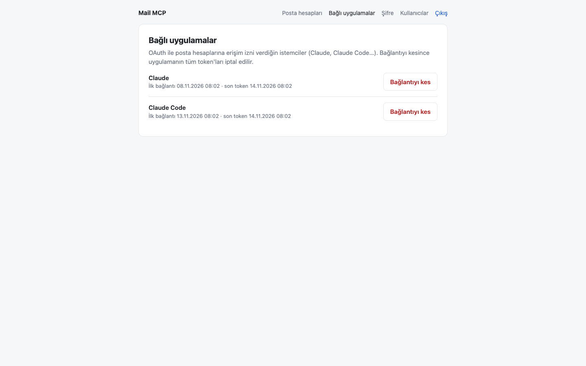
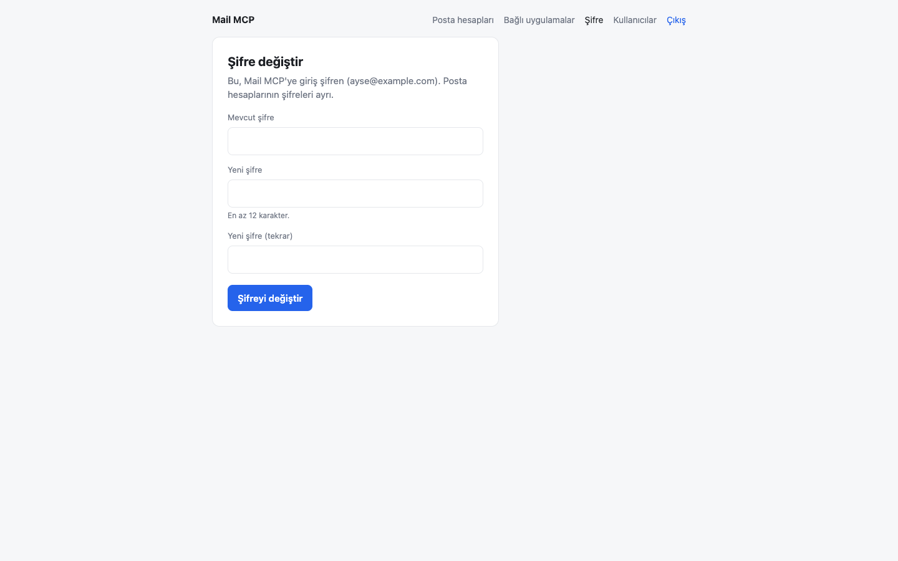
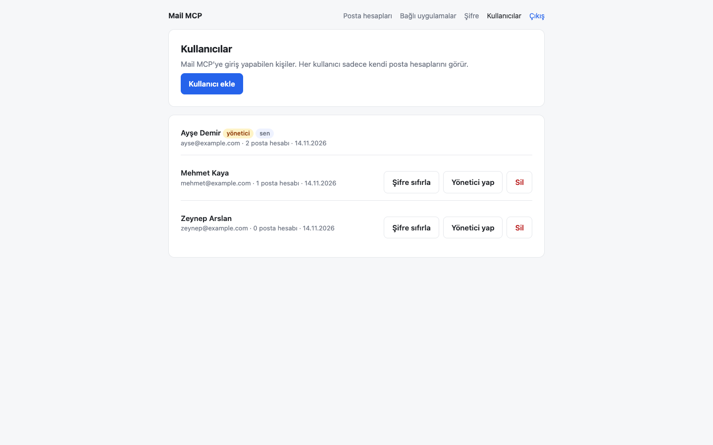
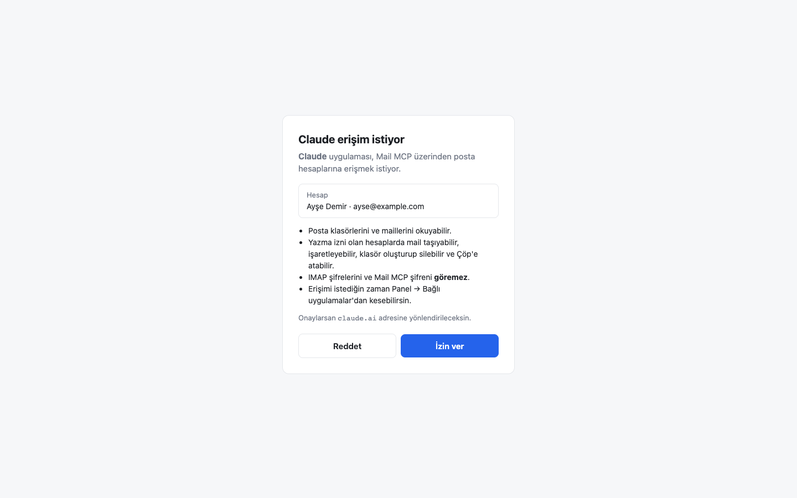

🇬🇧 English | [🇹🇷 Türkçe](features.tr.md)

[← Back to README](../README.md)

# Feature guide

The web panel is where users sign in, add their IMAP accounts and manage the AI apps connected to them.
The interface is in Turkish; button names are given below in Turkish with an English translation.

- [Home page](#home-page)
- [Login](#login)
- [Mail accounts](#mail-accounts)
- [Adding or editing an account](#adding-or-editing-an-account)
- [Connected apps](#connected-apps)
- [Password](#password)
- [Users (admins only)](#users-admins-only)
- [Consent screen](#consent-screen)

## Home page

`https://your-domain/` in a browser shows an introduction page with the MCP address and a **Kopyala** (Copy)
button. MCP clients use the same address; the server tells them apart by the request.

## Login

`/login`. There is no sign-up form: users are created by an admin or with `mail:create-user`.
Five failed attempts per minute are allowed.

## Mail accounts

**Posta hesapları** (Mail accounts) lists the IMAP mailboxes the AI can reach. Each row shows the label,
username, server and badges:

- **varsayılan** (default): used when the AI does not name an account.
- **salt okuma** (read-only) or **okuma + yazma** (read + write).

Buttons:

- **Hesap ekle** (Add account)
- **Bağlantıyı test et** (Test connection): connects to IMAP and reports the folder count.
- **Düzenle** (Edit)
- **Sil** (Delete): removes the account from imap-mcp only. Mail in the mailbox is not touched.

The **Claude'a bağlama** (Connecting to Claude) box at the bottom shows the address to paste into claude.ai.

## Adding or editing an account

The connection is tested before saving. The password is stored encrypted and never sent to the AI.

| Field | Meaning |
|---|---|
| Label | Short name the AI uses to pick the account (lowercase letters, digits, `-` `.` `_`) |
| IMAP sunucusu / Port / Şifreleme | IMAP server, port and encryption (SSL/TLS 993, STARTTLS 143, TLS, none) |
| TLS sertifikasını doğrula | Verify the TLS certificate. Turn off only for self-signed internal servers. |
| Kullanıcı adı / Şifre | IMAP username and password. An app password is recommended. Leave the password empty when editing to keep the current one. |
| Yazma izni | Write access: create folders, move, flag and delete mail |
| Çöp klasörü | Trash folder. If empty, `Trash`, `Çöp`, `Deleted Items` and similar names are detected. |
| Varsayılan hesap | Default account |

Buttons: **Test et ve kaydet** (Test and save) for a new account, **Kaydet** (Save) when editing, **Vazgeç** (Cancel).

## Connected apps

**Bağlı uygulamalar** (Connected apps) lists the OAuth clients (Claude, Claude Code…) the user has
authorised, with the first connection time and the last token time. **Bağlantıyı kes** (Disconnect) revokes
all access and refresh tokens of that app.

## Password

**Şifre** (Password) changes the user's imap-mcp login password (at least 12 characters). IMAP passwords are
separate and are changed on the account form.

## Users (admins only)

**Kullanıcılar** (Users) is visible only to admins. Admins never see other users' IMAP details.

- **Kullanıcı ekle** (Add user): name, email, optional admin role. The password is generated and shown once.
- **Şifre sıfırla** (Reset password): generates a new password; the old one stops working.
- **Yönetici yap / Yöneticiliği kaldır** (Make admin / Remove admin)
- **Sil** (Delete): also removes the user's mail account definitions and connected apps.

The first user created with `mail:create-user` is always an admin.

## Consent screen

When an AI client connects, the user signs in and sees what the app will be able to do. If any account has
write access, the extra permissions are listed. **İzin ver** (Allow) or **Reddet** (Deny).

