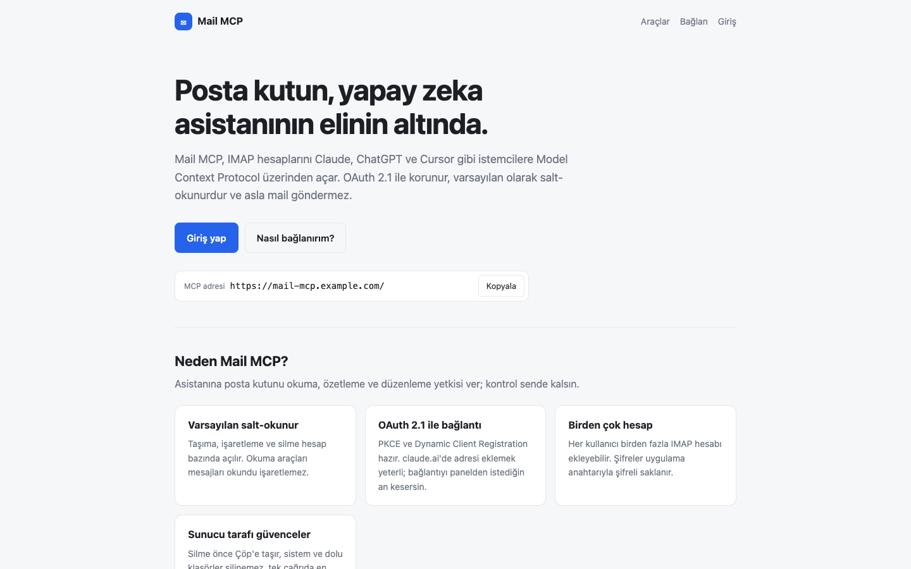
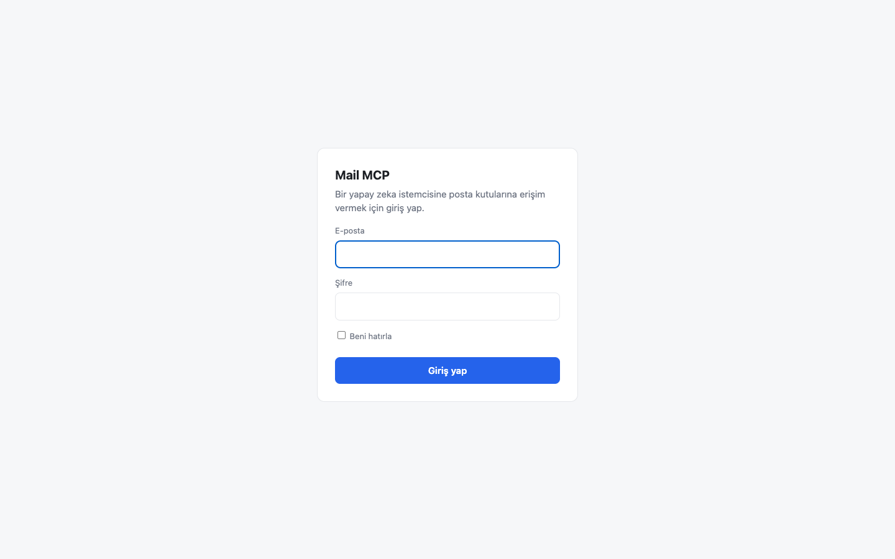
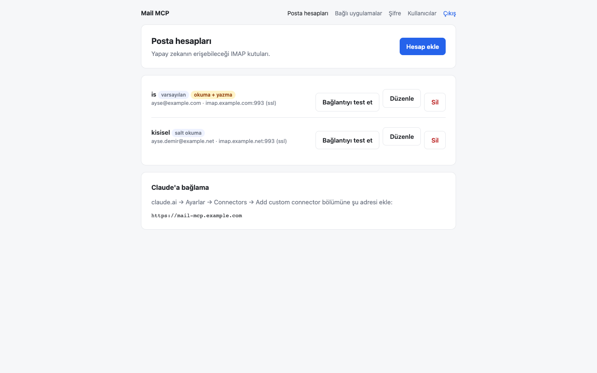
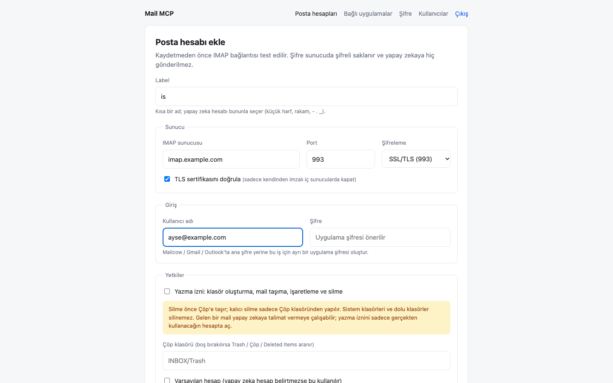
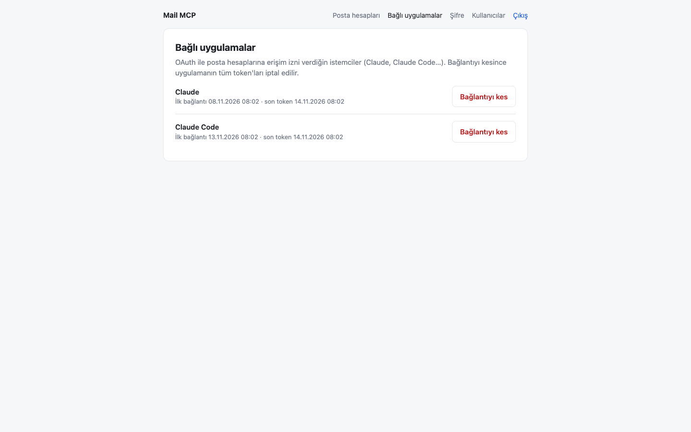
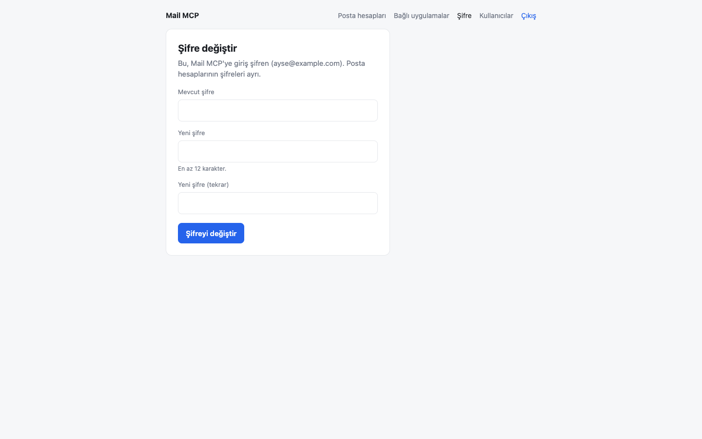
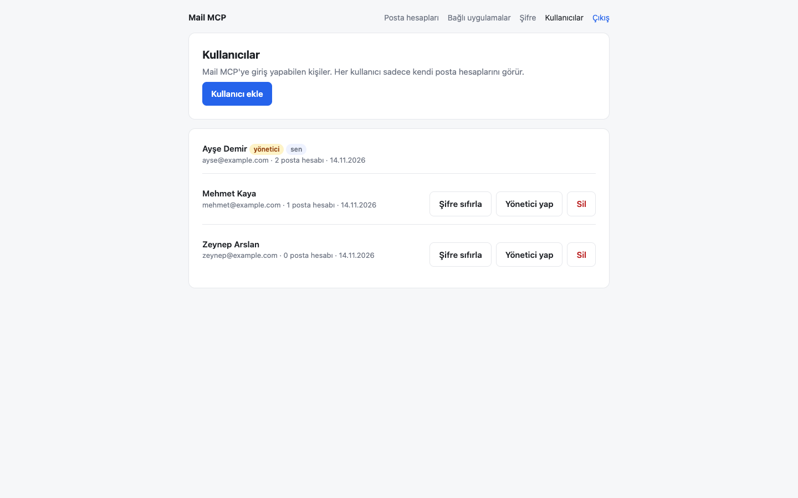
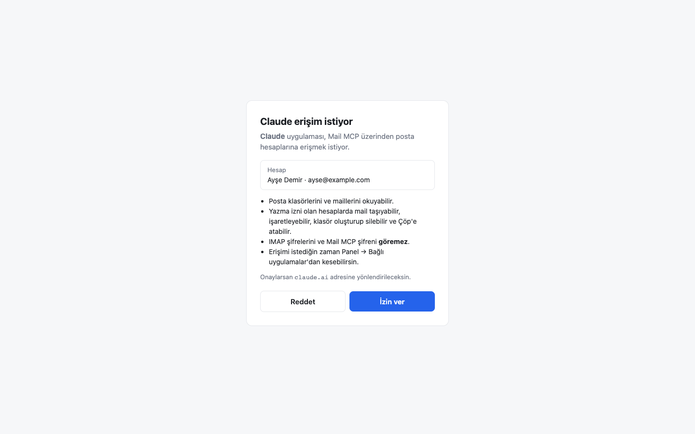

🇹🇷 Türkçe | [🇬🇧 English](features.md)

[← README'ye dön](../README.tr.md)

# Özellik rehberi

Web paneli, kullanıcıların giriş yaptığı, IMAP hesaplarını eklediği ve bağlı yapay zeka uygulamalarını
yönettiği yerdir.

- [Ana sayfa](#ana-sayfa)
- [Giriş](#giriş)
- [Posta hesapları](#posta-hesapları)
- [Hesap ekleme ve düzenleme](#hesap-ekleme-ve-düzenleme)
- [Bağlı uygulamalar](#bağlı-uygulamalar)
- [Şifre](#şifre)
- [Kullanıcılar (sadece yöneticiler)](#kullanıcılar-sadece-yöneticiler)
- [Onay ekranı](#onay-ekranı)

## Ana sayfa

Tarayıcıda `https://alanadin/` açıldığında MCP adresini ve **Kopyala** düğmesini gösteren bir tanıtım sayfası
gelir. MCP istemcileri de aynı adresi kullanır; sunucu ikisini istekten ayırt eder.

## Giriş

`/login`. Kayıt formu yok: kullanıcıları bir yönetici ya da `mail:create-user` oluşturur.
Dakikada en fazla 5 başarısız deneme yapılabilir.

## Posta hesapları

**Posta hesapları**, yapay zekanın erişebileceği IMAP kutularını listeler. Her satırda label, kullanıcı adı,
sunucu ve etiketler görünür:

- **varsayılan**: yapay zeka hesap belirtmezse bu kullanılır.
- **salt okuma** veya **okuma + yazma**.

Düğmeler:

- **Hesap ekle**
- **Bağlantıyı test et**: IMAP'e bağlanır ve klasör sayısını bildirir.
- **Düzenle**
- **Sil**: hesabı yalnızca imap-mcp'den kaldırır. Posta kutusundaki maillere dokunulmaz.

Alttaki **Claude'a bağlama** kutusu claude.ai'ye yapıştırılacak adresi gösterir.

## Hesap ekleme ve düzenleme

Kaydetmeden önce bağlantı test edilir. Şifre şifreli saklanır ve yapay zekaya hiç gönderilmez.

| Alan | Anlamı |
|---|---|
| Label | Yapay zekanın hesabı seçtiği kısa ad (küçük harf, rakam, `-` `.` `_`) |
| IMAP sunucusu / Port / Şifreleme | SSL/TLS 993, STARTTLS 143, TLS veya yok |
| TLS sertifikasını doğrula | Sadece kendinden imzalı iç sunucularda kapat. |
| Kullanıcı adı / Şifre | IMAP kullanıcı adı ve şifresi. Uygulama şifresi önerilir. Düzenlerken şifre boş bırakılırsa mevcut şifre korunur. |
| Yazma izni | Klasör oluşturma, mail taşıma, işaretleme ve silme |
| Çöp klasörü | Boşsa `Trash`, `Çöp`, `Deleted Items` gibi adlar aranır. |
| Varsayılan hesap | Yapay zeka hesap belirtmezse bu kullanılır. |

Düğmeler: yeni hesapta **Test et ve kaydet**, düzenlemede **Kaydet**, **Vazgeç**.

## Bağlı uygulamalar

**Bağlı uygulamalar**, kullanıcının OAuth ile yetki verdiği istemcileri (Claude, Claude Code…) ilk bağlantı ve
son token zamanıyla listeler. **Bağlantıyı kes** o uygulamanın tüm access ve refresh token'larını iptal eder.

## Şifre

**Şifre** sayfası kullanıcının imap-mcp giriş şifresini değiştirir (en az 12 karakter). IMAP şifreleri
ayrıdır ve hesap formunda değiştirilir.

## Kullanıcılar (sadece yöneticiler)

**Kullanıcılar** yalnızca yöneticilere görünür. Yönetici başka kullanıcıların IMAP bilgilerini görmez.

- **Kullanıcı ekle**: ad, e-posta, isteğe bağlı yönetici rolü. Şifre otomatik üretilir ve bir kez gösterilir.
- **Şifre sıfırla**: yeni şifre üretir; eskisi çalışmayı bırakır.
- **Yönetici yap / Yöneticiliği kaldır**
- **Sil**: kullanıcının posta hesap tanımlarını ve bağlı uygulamalarını da kaldırır.

`mail:create-user` ile oluşturulan ilk kullanıcı her zaman yöneticidir.

## Onay ekranı

Bir yapay zeka istemcisi bağlanırken kullanıcı giriş yapar ve uygulamanın neler yapabileceğini görür.
Yazma izni olan bir hesap varsa ek yetkiler de listelenir. **İzin ver** veya **Reddet**.

